<h1 align="center">
  <picture>
    <source media="(prefers-reduced-motion: no-preference)" srcset="./assets/jarvis/hero.svg">
    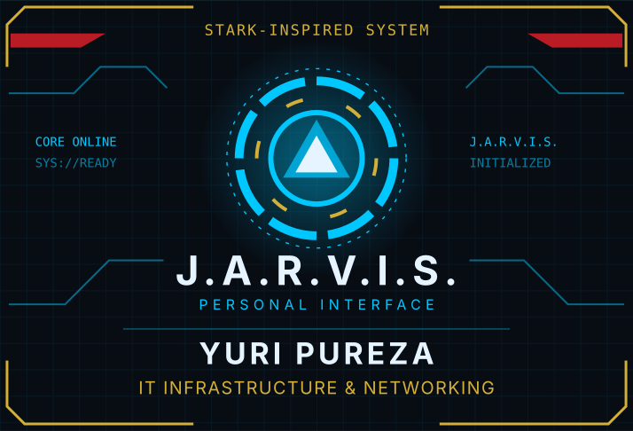
  </picture>
</h1>

  

<h2 align="center">
  <picture>
    <source media="(max-width: 560px)" srcset="./assets/jarvis/operator-profile-compact.svg">
    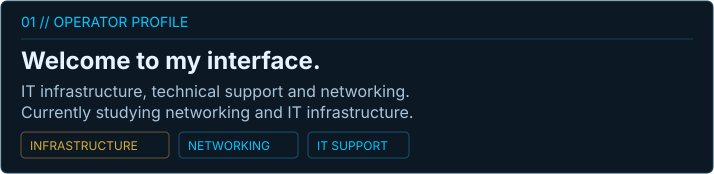
  </picture>
</h2>

<h2 align="center">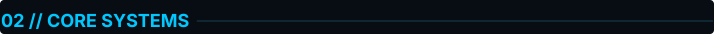</h2>

  <picture>
    <source media="(max-width: 560px)" srcset="./assets/jarvis/core-systems-compact.svg">
    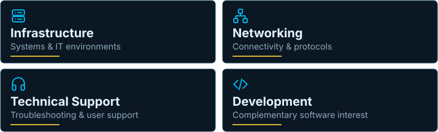
  </picture>

<h2 align="center">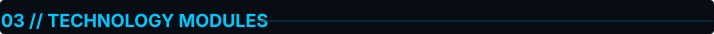</h2>

  <picture>
    <source media="(max-width: 560px)" srcset="./assets/jarvis/technology-modules-compact.svg">
    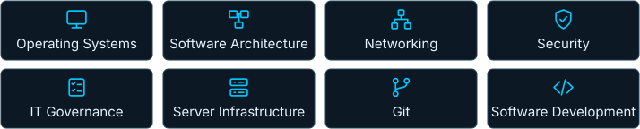
  </picture>

<h2 align="center">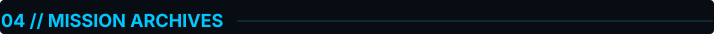</h2>

<h3 align="center">
  <a href="https://github.com/YuriPureza/Projeto_E.E.G.D">
    <picture>
      <source media="(max-width: 560px)" srcset="./assets/jarvis/mission-eegd-compact.svg">
      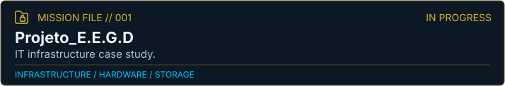
    </picture>
  </a>
</h3>

<h3 align="center">
  <picture>
    <source media="(max-width: 560px)" srcset="./assets/jarvis/mission-tony-stark-compact.svg">
    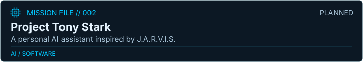
  </picture>
</h3>

<h2 align="center">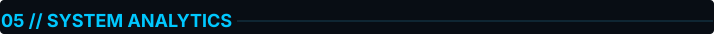</h2>

  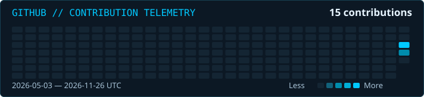
   
  <a href="https://github.com/YuriPureza">View contribution activity on GitHub</a>

  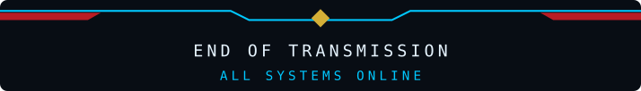

  Projeto feito por mim utilizando o codex da OpenAI

